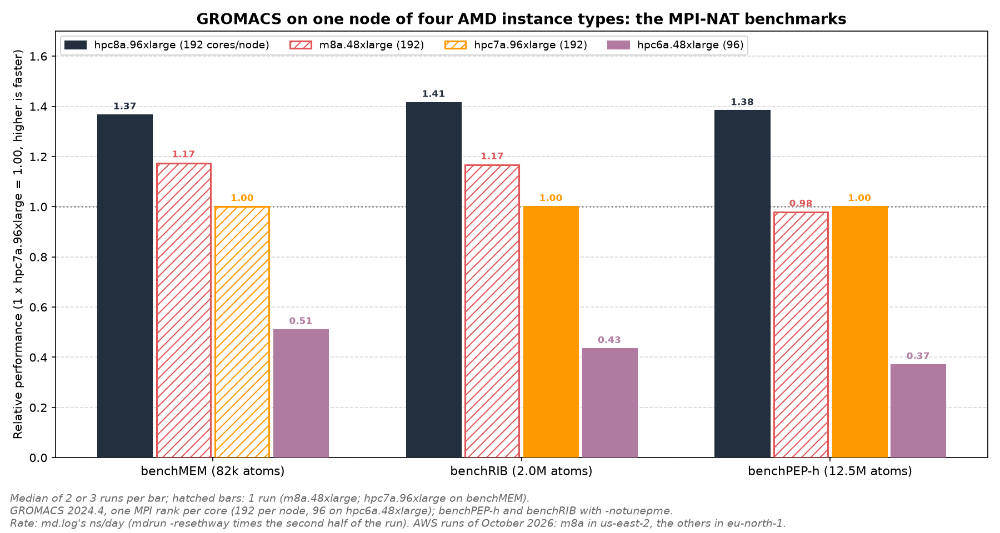
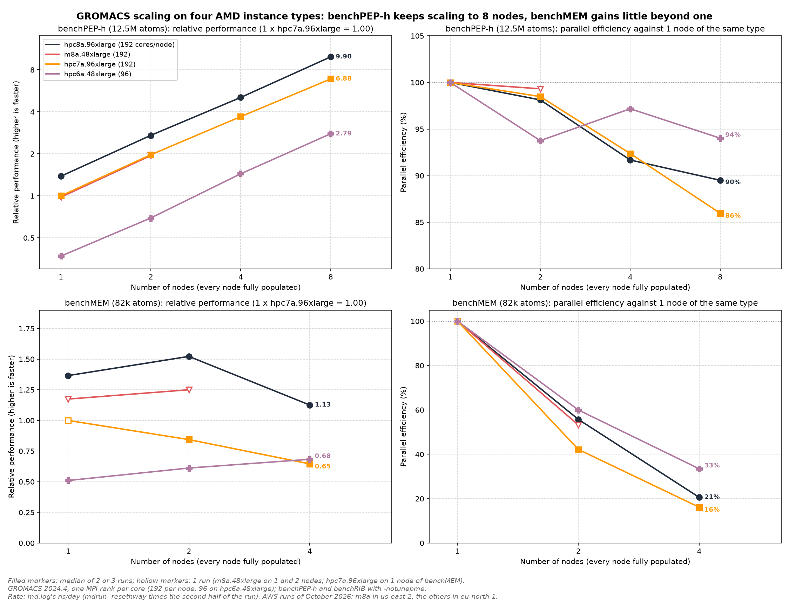
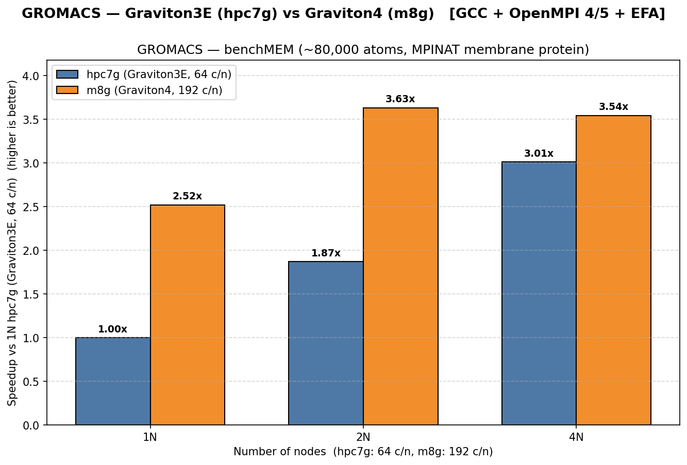
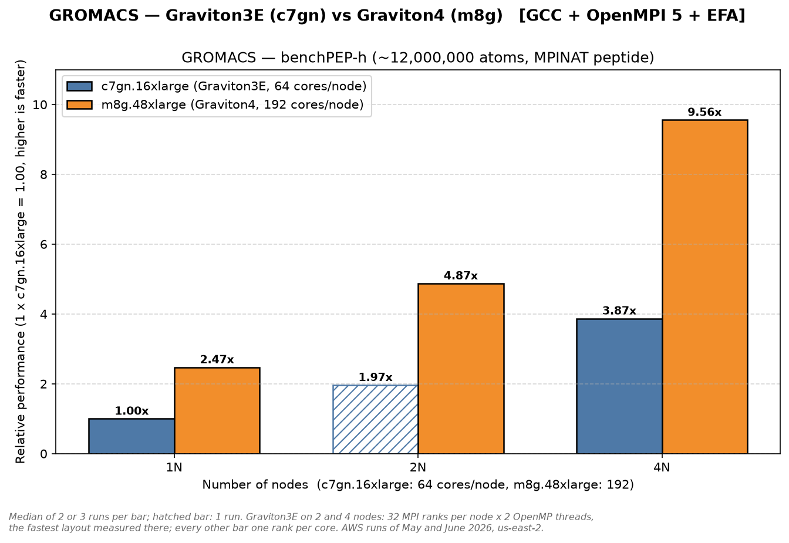
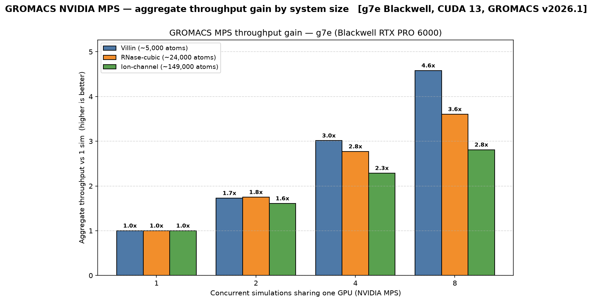

# GROMACS

This directory contains scripts for building and benchmarking [GROMACS](https://www.gromacs.org/) on AWS HPC instances. GROMACS is the workhorse open-source molecular dynamics package for biomolecular simulation — proteins, lipids, nucleic acids, and condensed-matter systems.

The scripts are organised by CPU architecture:

- [`x86/`](x86/) — builds and benchmarks for x86_64 (`hpc8a`, `hpc7a`, `hpc6a`, `c8i`, `m8a`)
- [`Arm/`](Arm/) — builds and benchmarks for aarch64 (`hpc7g` / Graviton3E, `m8g` / Graviton4)
- `GPU/` — CUDA 13 build scripts for `g6e` (L40S), `g7e` (Blackwell RTX PRO 6000), and `p5` (H100), plus the NVIDIA MPS GPU-sharing benchmark that is the recommended throughput pattern (see Performance → GPU)

Unlike LAMMPS, GROMACS ships **two binaries per build**: `gmx` (Thread_MPI, single-node) and `gmx_mpi` (Library_MPI, multi-node over EFA). Both binaries come from the same build script — they're separate CMake trees installed side-by-side under `tmpi/` and `ompi/`. The benchmark launcher picks the right one based on `SLURM_JOB_NUM_NODES`: 1 node → `gmx`, >1 node → `mpirun … gmx_mpi`.

## Best practices in brief

From AWS runs of October 2026 on six instance types, with the benchmarks of the MPI-NAT set, each CPU vendor's results against one node of the same vendor (see [Performance](#performance)):

- **Instance type.** Of the four AMD types measured, `hpc8a.96xlarge` was the fastest node on all three benchmarks: 1.37× (benchMEM) to 1.41× (benchRIB) the rate of one `hpc7a.96xlarge` node, and 1.37–1.44× hpc7a's at every node count of benchPEP-h. On one node, `m8a.48xlarge` reached 0.98–1.17× (1 run each) and `hpc6a.48xlarge` (96 cores, AVX2) 0.37–0.51×. Intel and Graviton were measured on one type each, `c8i.96xlarge` and `m8g.48xlarge` (Graviton4): their results are their scaling against one node of the same type (see [Intel](#intel-c8i96xlarge) and [Graviton4](#graviton4-m8g48xlarge)).
- **Node count.** Large systems scale, small ones do not: run a system of benchMEM's size (82k atoms) on one node.
  - AMD: benchPEP-h (12.5M atoms) kept 86–94% parallel efficiency on 8 nodes (1,536 cores on hpc8a and hpc7a, 768 on hpc6a). No node count gave benchMEM more than 1.34× its one-node rate, and on hpc7a every added node made it slower.
  - Intel: on 2 `c8i.96xlarge` nodes, benchPEP-h ran at 101% parallel efficiency, and benchMEM at 0.85× the rate of one node (1 run).
  - Graviton4: on 8 `m8g.48xlarge` nodes, benchPEP-h kept 94% parallel efficiency; benchMEM gained most on 2 nodes, 1.27× the rate of one node.
- **Layout.** Every October 2026 result under [Performance](#performance) (the AMD charts and tables, and the Intel and Graviton4 tables) was measured with one MPI rank per core and one OpenMP thread (`THREADS_PER_RANK=1`, the default). In an earlier sweep, 48 ranks × 4 threads per node ran benchMEM on 4 hpc8a nodes at 1.09× the rate of one rank per core (against one 192 × 1 run): try 2 or 4 threads per rank when a small system is spread over many nodes. See [MPI ranks and OpenMP threads](#mpi-ranks-and-openmp-threads).
- **PME.** Benchmark large systems (benchPEP-h, benchRIB) with `-notunepme`, and give benchRIB a quarter of its ranks for PME (`-npme`). Under `-nstlist 100` its box allows at most 7 × 7 × 6 particle-particle domains, which with that split rules out 2 or more nodes of the 192-core types, and 4 or more `hpc6a.48xlarge` nodes. See [PME settings](#pme-settings).
- **Build and node setup.** One AVX-512 build serves hpc8a, hpc7a, c8i and m8a; hpc6a (Zen 3) needs an AVX2 build, and Graviton4 OpenMPI 5. Run one rank per physical core: the c8i runs had SMT turned off (ParallelCluster's `DisableSimultaneousMultithreading: true`; hpc8a, hpc7a, hpc6a, m8a and Graviton have one thread per core).

## Build Variants

### x86 — Thread_MPI + Library_MPI

A single build script produces **both** variants in one job — two CMake trees, two installs, two env scripts. It targets AVX-512 with GCC + system OpenMPI 4.1.7; the same binary ran on every AVX-512 type measured here: hpc8a (Zen 5), hpc7a (Zen 4), m8a (Zen 5) and c8i (Intel Xeon 6):

```bash
sbatch x86/build_gromacs_x86.sbatch
```

- Compiler: GCC 11.5 (system, AL2023)
- Flags: `-O3 -march=x86-64-v4 -mtune=znver4 -DNDEBUG` (AVX-512, Zen 4/5 tuning)
- SIMD: `-DGMX_SIMD=AVX_512`
- FFT: in-tree FFTW3 via `-DGMX_BUILD_OWN_FFTW=ON`
- MPI: system OpenMPI 4.1.7 at `/opt/amazon/openmpi` (EFA-enabled at runtime)
- Build time: ~25–30 minutes (both variants)

Outputs:

| Variant | CMake | Binary | Install location | Env script |
|---------|-------|--------|------------------|------------|
| Thread_MPI | `-DGMX_MPI=OFF -DGMX_THREAD_MPI=ON` | `gmx` | `/fsx/gromacs/x86_64/<tag>/tmpi/bin/` | `gromacs-<tag>-tmpi-env.sh` |
| Library_MPI | `-DGMX_MPI=ON -DGMX_THREAD_MPI=OFF` | `gmx_mpi` | `/fsx/gromacs/x86_64/<tag>/ompi/bin/` | `gromacs-<tag>-ompi-env.sh` |

GCC 11.5 doesn't know `znver5`, so Zen 5 (hpc8a) is compiled with `-mtune=znver4` — AVX-512 is still emitted and the binary runs at full speed on Zen 5. Same trade-off the LAMMPS x86 build makes.

`hpc6a.48xlarge` (AMD EPYC Zen 3) has no AVX-512, so this build does not run on it. The hpc6a results under [Performance](#performance) come from an AVX2 build of the same GROMACS version, with `-O3 -march=x86-64-v3 -mtune=znver3 -DNDEBUG` and `-DGMX_SIMD=AVX2_256`, installed under its own prefix and selected with `GROMACS_ENV`. The script's `TARGET_CPU=generic-avx2` does not make such a build: it changes the compiler flags only, keeps `-DGMX_SIMD=AVX_512`, and installs into the same `x86_64/<tag>/` prefix as the AVX-512 build.

Override via `--export=ALL,...`:

| Variable | Default | Description |
|----------|---------|-------------|
| `GROMACS_TAG` | `v2024.4` | Git tag from the [GROMACS GitLab](https://gitlab.com/gromacs/gromacs) |
| `TARGET_CPU` | `hpc8a` | `hpc8a` / `hpc7a` (AVX-512 Zen 4/5) |
| `BASE_DIR` | `/fsx/gromacs` | Install root |
| `COMPILE_CORES` | `48` | Parallel compile threads |

### Arm — Thread_MPI + Library_MPI

A single build script produces **both** variants in one job — Thread_MPI (`gmx`) and Library_MPI (`gmx_mpi`) — and auto-detects Graviton3E (CPU part `0xd40`) vs Graviton4 (`0xd4f`) from `/proc/cpuinfo`. SIMD: `-DGMX_SIMD=ARM_SVE` after a configure-time SVE probe (falls back to `ARM_NEON_ASIMD` only if the probe fails). FFT: in-tree FFTW3 via `-DGMX_BUILD_OWN_FFTW=ON`.

```bash
# hpc7g (Graviton3E, Neoverse V1) — default OpenMPI 5
sbatch Arm/build_gromacs_arm.sbatch

# hpc7g (Graviton3E, Neoverse V1) — legacy OpenMPI 4 baseline
sbatch --export=ALL,OMPI_VERSION=4 Arm/build_gromacs_arm.sbatch

# m8g (Graviton4, Neoverse V2) — OpenMPI 5 forced (192 ranks/node EFA scaling)
sbatch -p m8g --ntasks-per-node=192 Arm/build_gromacs_arm.sbatch
```

- Compiler: GCC 11.5 (system, AL2023)
- CPU flags: `-mcpu=neoverse-v1` on Graviton3E, `-mcpu=neoverse-v2` on Graviton4
- MPI: system OpenMPI 4.1.7 at `/opt/amazon/openmpi` (Graviton3E only) **or** OpenMPI 5.0.9 at `/opt/amazon/openmpi5` (default on Graviton3E, required on Graviton4)
- Build time: ~30–35 minutes (both variants)

Outputs (the `-ompi5` install-dir suffix is present **iff** the Library_MPI variant linked against OpenMPI 5):

| Target | OpenMPI | Binary | Install location | Env script |
|--------|---------|--------|------------------|------------|
| Graviton3E | 4.1.7 | `gmx` (Thread_MPI) | `/fsx/gromacs/aarch64-graviton3/<tag>/tmpi/bin/` | `gromacs-<tag>-tmpi-env.sh` |
| Graviton3E | 4.1.7 | `gmx_mpi` (Library_MPI) | `/fsx/gromacs/aarch64-graviton3/<tag>/ompi/bin/` | `gromacs-<tag>-ompi-env.sh` |
| Graviton3E | 5.0.9 | `gmx` (Thread_MPI) | `/fsx/gromacs/aarch64-graviton3-ompi5/<tag>/tmpi/bin/` | `gromacs-<tag>-tmpi-env.sh` |
| Graviton3E | 5.0.9 | `gmx_mpi` (Library_MPI) | `/fsx/gromacs/aarch64-graviton3-ompi5/<tag>/ompi/bin/` | `gromacs-<tag>-ompi5-env.sh` |
| Graviton4 | 5.0.9 | `gmx` (Thread_MPI) | `/fsx/gromacs/aarch64-graviton4-ompi5/<tag>/tmpi/bin/` | `gromacs-<tag>-tmpi-env.sh` |
| Graviton4 | 5.0.9 | `gmx_mpi` (Library_MPI) | `/fsx/gromacs/aarch64-graviton4-ompi5/<tag>/ompi/bin/` | `gromacs-<tag>-ompi5-env.sh` |

Graviton4 + OpenMPI 4 is **rejected at submit time** — OpenMPI 4.1.7 cannot scale to 192 EFA endpoints/node on Neoverse V2. Pass `OMPI_VERSION=5` (the default) or omit it entirely on m8g.

Override via `--export=ALL,...`:

| Variable | Default | Description |
|----------|---------|-------------|
| `GROMACS_TAG` | `v2024.4` | Git tag from the [GROMACS GitLab](https://gitlab.com/gromacs/gromacs) |
| `OMPI_VERSION` | `5` | `4` (Graviton3E only) or `5` |
| `TARGET` | `auto` | `graviton3` / `graviton4` / `auto` (auto-detects from `/proc/cpuinfo`) |
| `BASE_DIR` | `/fsx/gromacs` | Install root |
| `COMPILE_CORES` | `48` | Parallel compile threads |

### GPU — Thread_MPI + Library_MPI + CUDA

A single build script produces **both** Thread_MPI (`gmx`) and Library_MPI (`gmx_mpi`) variants in one job, both linked against CUDA 13, and auto-detects L40S (g6e, sm_89), Blackwell RTX PRO 6000 (g7e, sm_120), and H100 (p5, sm_90) from `nvidia-smi --query-gpu=name`. Pins **GROMACS v2026.1**: the GPU nodes ship CUDA 13.0 and GROMACS 2024.4 cannot build against CUDA 13 (upstream added CUDA 13 support in 2025.3). SIMD: the host SIMD level is **auto-detected** from `/proc/cpuinfo` (`AVX_512` / `AVX2_256` / `SSE4.1`) with `-march=native` — the g6e/p5 host CPUs do not all advertise AVX-512, and for a GPU build the host SIMD barely matters since force/PME/bonded/update run on the GPU. FFT: in-tree FFTW3 via `-DGMX_BUILD_OWN_FFTW=ON`. The build aborts within 30 s on a host without `nvidia-smi`, without `nvcc`, or with CUDA toolkit major version below 13.

GROMACS 2026 needs C++20 (GCC ≥ 12) and CMake ≥ 3.28, and the Blackwell `sm_120` target needs a recent nvcc, so the build uses **GCC 14** (AL2023 `gcc14`/`gcc14-c++`/`gcc14-gfortran`, installed as `/usr/bin/gcc14-gcc` / `gcc14-g++`) and a **CMake 3.28.3** staged on shared FSx at `/fsx/tools`.

```bash
# g6e (L40S, sm_89) — default partition, 1 GPU job
sbatch GPU/build_gromacs_gpu.sbatch

# g7e (Blackwell RTX PRO 6000, sm_120) — 8-GPU node
sbatch -p g7e --gres=gpu:8 GPU/build_gromacs_gpu.sbatch

# p5 (H100, sm_90) — 8-GPU node
sbatch -p p5 --gres=gpu:8 GPU/build_gromacs_gpu.sbatch

# Force the OpenMPI 5 link instead of the default OpenMPI 4
sbatch --export=ALL,OMPI_VERSION=5 GPU/build_gromacs_gpu.sbatch
```

- Compiler: GCC 14 (AL2023 `gcc14`) + `nvcc` from CUDA 13 on PATH (>= 13 required)
- Host flags: `-O3 -march=native -DNDEBUG` (host SIMD auto-detected from `/proc/cpuinfo`)
- CUDA flags: `-DGMX_GPU=CUDA -DGMX_CUDA_TARGET_SM="<89|90|120>" -DCMAKE_CUDA_FLAGS=--use_fast_math -DGMX_RELAXED_DOUBLE_PRECISION=OFF` (SM chosen per detected GPU family)
- MPI: system OpenMPI 4.1.7 at `/opt/amazon/openmpi` (default) **or** OpenMPI 5.0.9 at `/opt/amazon/openmpi5` (set `OMPI_VERSION=5`)
- Build time: ~30–40 minutes (both variants, dominated by `nvcc`)

The build probes the linked OpenMPI for CUDA-aware support (`ompi_info | grep mpi_built_with_cuda_support`) and emits one of two comments at the top of the generated `*-ompi[5]-env.sh` so the launcher and any human reading the env file knows whether inter-GPU collectives go through CUDA-aware MPI or fall back to NCCL:

```bash
# MPI is CUDA-aware
# MPI is not CUDA-aware; NCCL is used for inter-GPU collectives
```

Outputs (the `tmpi/` directory holds the `gmx` Thread_MPI binary used for single-node multi-GPU runs; `ompi/` holds the `gmx_mpi` Library_MPI binary used for multi-node GPU runs under `mpirun`):

| GPU target | CUDA SM | Install location | Env scripts |
|------------|---------|------------------|-------------|
| L40S (g6e) | sm_89 | `/fsx/gromacs/x86_64-cuda13-l40s/<tag>/{tmpi,ompi}/bin/` | `gromacs-<tag>-tmpi-env.sh`, `gromacs-<tag>-ompi-env.sh` (or `…-ompi5-env.sh` if `OMPI_VERSION=5`) |
| Blackwell (g7e) | sm_120 | `/fsx/gromacs/x86_64-cuda13-blackwell/<tag>/{tmpi,ompi}/bin/` | `gromacs-<tag>-tmpi-env.sh`, `gromacs-<tag>-ompi-env.sh` (or `…-ompi5-env.sh` if `OMPI_VERSION=5`) |
| H100 (p5) | sm_90 | `/fsx/gromacs/x86_64-cuda13-h100/<tag>/{tmpi,ompi}/bin/` | `gromacs-<tag>-tmpi-env.sh`, `gromacs-<tag>-ompi-env.sh` (or `…-ompi5-env.sh` if `OMPI_VERSION=5`) |

Both env scripts also export a default `CUDA_VISIBLE_DEVICES=0,1,…,N-1` covering every GPU detected on the build host so a freshly-sourced env script picks up all visible GPUs by default. The launcher tightens that to the first `GPU_COUNT` GPUs at run time.

Override via `--export=ALL,...`:

| Variable | Default | Description |
|----------|---------|-------------|
| `GROMACS_TAG` | `v2026.1` | Git tag from the [GROMACS GitLab](https://gitlab.com/gromacs/gromacs) |
| `GPU_TARGET` | `auto` | `l40s` / `blackwell` / `h100` / `auto` (auto-detects from `nvidia-smi --query-gpu=name`) |
| `CUDA_TOOLKIT` | `13` | Minimum CUDA major version required on PATH (build aborts if `nvcc --version` reports below this) |
| `OMPI_VERSION` | `4` | `4` or `5` — controls which OpenMPI module is loaded for the Library_MPI variant |
| `BASE_DIR` | `/fsx/gromacs` | Install root |
| `COMPILE_CORES` | `48` | Parallel compile threads |

## Benchmark Models

The launchers select the benchmark with the `MODEL` environment variable. benchMEM and benchPEP-h come from the [MPI-NAT GROMACS benchmark set](https://www.mpinat.mpg.de/grubmueller/bench) of the Max Planck Institute for Multidisciplinary Sciences (Department of Theoretical and Computational Biophysics; its `.tpr` files are licensed CC-BY 4.0). That set also holds benchRIB (2.0M atoms), which the launchers do not run; it is measured under [Performance](#performance), with a quarter of its ranks on PME (see [PME settings](#pme-settings)).

| `MODEL` | System | Atoms | Time step | Default `nsteps` | Notes |
|---------|--------|------:|----------:|-----------------:|-------|
| `benchMEM` | Aquaporin in a lipid membrane, in water | 81,743 | 2 fs | 50,000 | PME; the small reference: it gains little beyond one node |
| `benchPEP-h` | Peptides in water, h-bonds constrained | 12,495,503 | 2 fs | 5,000 | PME, `-notunepme`; the strong-scaling reference |
| `STMV` | Satellite Tobacco Mosaic Virus capsid in water | ~1,000,000 | | 10,000 | Not part of the MPI-NAT set: stage its `.tpr` yourself |
| `RNAse` | RNAse small protein in water | ~24,000 | | 100,000 | Not part of the MPI-NAT set: stage its `.tpr` yourself |

Unlike LAMMPS, GROMACS benchmarks are **not scaled** — the `.tpr` files have fixed atom counts and `MODEL` is the only problem-size selector.

On first use, the launchers download the MPI-NAT decks from `https://www.mpinat.mpg.de/<MODEL>` (zip archives), extract the `.tpr`, and cache it on FSx at `/fsx/gromacs/benchmarks/<MODEL>/<MODEL>.tpr` (cluster-shared, readable by all users). Later runs reuse the cached `.tpr` without any network request. STMV and RNAse have no deck at that address: put their `.tpr` at that path before the first run.

### x86 examples

```bash
# benchMEM on hpc8a, one node — Thread_MPI auto-selected
sbatch --nodes=1 x86/gromacs-benchmark.sbatch

# benchPEP-h scaling on hpc8a — 1N uses gmx (Thread_MPI), 2N+ uses gmx_mpi over EFA
for N in 1 2 4 8; do
  sbatch --nodes=$N --export=ALL,MODEL=benchPEP-h \
    x86/gromacs-benchmark.sbatch
done

# benchPEP-h on hpc7a, 4 nodes
sbatch -p hpc7a --ntasks-per-node=192 --nodes=4 \
  --export=ALL,MODEL=benchPEP-h \
  x86/gromacs-benchmark.sbatch

# benchMEM on 4 hpc8a nodes with 4 OpenMP threads per rank (48 ranks x 4 threads per node)
sbatch --nodes=4 --export=ALL,MODEL=benchMEM,THREADS_PER_RANK=4 \
  x86/gromacs-benchmark.sbatch

# c8i (Intel Xeon 6, SMT off): 192 ranks per node
sbatch -p c8i --ntasks-per-node=192 --nodes=2 \
  --export=ALL,MODEL=benchPEP-h \
  x86/gromacs-benchmark.sbatch
```

### Arm examples

```bash
# benchMEM on hpc7g, single node — Thread_MPI auto-selected
sbatch --nodes=1 Arm/gromacs-benchmark.sbatch

# benchPEP-h strong-scaling on hpc7g, 4 nodes
sbatch --nodes=4 --export=ALL,MODEL=benchPEP-h Arm/gromacs-benchmark.sbatch

# benchMEM on m8g (Graviton4), single node, 192 ranks
sbatch -p m8g --ntasks-per-node=192 --nodes=1 \
  --export=ALL,MODEL=benchMEM \
  Arm/gromacs-benchmark.sbatch

# benchPEP-h strong-scaling on m8g, 8 nodes — full-density 192 rpn EFA endpoints
sbatch -p m8g --ntasks-per-node=192 --nodes=8 \
  --export=ALL,MODEL=benchPEP-h \
  Arm/gromacs-benchmark.sbatch
```

The Arm launcher auto-discovers the most recently modified env script under `aarch64-graviton4-ompi5/<tag>/`, then `aarch64-graviton3-ompi5/<tag>/`, then `aarch64-graviton3/<tag>/`. Override with `--export=ALL,GROMACS_ENV=/path/to/gromacs-<tag>-ompi5-env.sh` to pin a specific build (e.g., to compare Graviton3E + OpenMPI 4 against Graviton3E + OpenMPI 5 on the same hardware). Graviton4 + OpenMPI 4 is rejected at submit time — same constraint as the build script.

### GPU examples — single-simulation launcher (reference only)

> **For throughput workloads, use the MPS GPU-sharing benchmark ([`GPU/gromacs-mps-benchmark.sbatch`](GPU/gromacs-mps-benchmark.sbatch)), not this launcher.** The single-simulation launcher below scales *one* GROMACS simulation across multiple GPUs. **Based on our benchmarking, this is generally not the best approach for these instances**: a single simulation under-utilizes a modern GPU, and spreading it across GPUs **anti-scales over PCIe** (throughput *drops* as GPUs are added — see Performance → GPU). We keep this launcher as a single-GPU reference and for the rare large system that genuinely needs multi-GPU, but for most GROMACS GPU workloads MPS GPU-sharing gives far higher aggregate throughput. Do not use this launcher's multi-GPU scaling numbers for customer recommendations.

The GPU launcher dispatches to one of three execution paths based on `GPU_COUNT` vs detected GPUs/node:

- **`GPU_COUNT == 1`** → source `*-tmpi-env.sh`, run `gmx mdrun -gpu_id 0` directly (Thread_MPI, single GPU)
- **`1 < GPU_COUNT <= GPUs/node`** → source `*-tmpi-env.sh`, run `gmx mdrun -ntmpi GPU_COUNT -gpu_id 0,1,…,(GPU_COUNT-1)` (Thread_MPI, single-node multi-GPU)
- **`GPU_COUNT > GPUs/node`** → source `*-ompi[5]-env.sh`, run `mpirun -np GPU_COUNT … gmx_mpi mdrun` with one rank per GPU (Library_MPI, multi-node)

`GPU_COUNT` is validated to `1..min(8, nvidia-smi -L count)` at submit time — out-of-range values exit non-zero with a descriptive error before any binary launches. `nvidia-smi topo -m` is captured at job start and the inter-GPU fabric is classified as `NVLink`, `NVSwitch`, or `PCIe` and printed on a single `GPU topology:` line so log scrapers can match it literally.

```bash
# benchMEM on g6e (L40S), 1 GPU — Thread_MPI auto-selected
sbatch -p g6e --gres=gpu:1 GPU/gromacs-benchmark.sbatch

# RNAse smoke test on g6e, 1 GPU
sbatch -p g6e --gres=gpu:1 --export=ALL,MODEL=RNAse GPU/gromacs-benchmark.sbatch

# benchMEM on g6e, 4 GPUs — Thread_MPI multi-GPU on a single node
sbatch -p g6e --gres=gpu:4 --export=ALL,MODEL=benchMEM,GPU_COUNT=4 \
  GPU/gromacs-benchmark.sbatch

# STMV on g6e, 8 GPUs (full-node)
sbatch -p g6e --gres=gpu:8 --export=ALL,MODEL=STMV,GPU_COUNT=8 \
  GPU/gromacs-benchmark.sbatch

# benchMEM on p5 (H100), 1 GPU
sbatch -p p5 --gres=gpu:1 GPU/gromacs-benchmark.sbatch

# benchMEM on p5, 8 GPUs — full NVSwitch all-to-all on a single node
sbatch -p p5 --gres=gpu:8 --export=ALL,MODEL=benchMEM,GPU_COUNT=8 \
  GPU/gromacs-benchmark.sbatch

# benchPEP-h on p5, 8 GPUs — strong-scaling reference at 12M atoms
sbatch -p p5 --gres=gpu:8 --export=ALL,MODEL=benchPEP-h,GPU_COUNT=8 \
  GPU/gromacs-benchmark.sbatch
```

The launcher passes `-nb gpu -pme gpu -bonded "${GPU_BONDED:-auto}" -update "${GPU_UPDATE:-auto}"` to `gmx mdrun`. Non-bonded and PME always run on the GPU; `-bonded` and `-update` default to GROMACS `auto` because forcing `-update gpu` **aborts benchMEM** (its 3+ coupled constraints can't run under GPU LINCS). Override `GPU_BONDED` / `GPU_UPDATE` (`gpu`/`cpu`/`auto`) to force a split during tuning. Multi-GPU runs additionally pass `-npme 1` (a dedicated PME rank, required for PME-on-GPU with more than one rank), and `benchPEP-h` adds `-notunepme` (PME tuning does not converge by the `-resethway` midpoint on a 12M-atom system; override with `TUNEPME=on`).

The launcher also auto-discovers the most recently modified env script under `x86_64-cuda*-{l40s,blackwell,h100}/<tag>/`, picking the `*-tmpi-env.sh` for `GPU_COUNT <= GPUs/node` and the `*-ompi[5]-env.sh` for multi-node runs. Override with `--export=ALL,GROMACS_ENV=/path/to/gromacs-<tag>-tmpi-env.sh` to pin a specific build (e.g., to compare families on the same node count).

## Overrides

| Variable | Default | Description |
|----------|---------|-------------|
| `GROMACS_TAG` | `v2024.4` | Git tag the build script compiled (used in the install path and env-script filename) |
| `GROMACS_ENV` | auto-discovered | Path to environment setup script. If unset, the launcher picks the most recently modified env script under the per-architecture install root: `${BASE_DIR}/x86_64/<tag>/` for the x86 launcher, `${BASE_DIR}/aarch64-graviton{3,3-ompi5,4-ompi5}/<tag>/` for the Arm launcher, `${BASE_DIR}/x86_64-cuda*-{l40s,h100}/<tag>/` for the GPU launcher. Picks `*-tmpi-env.sh` for single-node / single-GPU and `*-ompi[5]-env.sh` for multi-node / multi-node-multi-GPU |
| `MODEL` | `benchMEM` | `benchMEM` / `benchPEP-h` / `STMV` / `RNAse` |
| `TIMESTEPS` | model default (see Benchmark Models) | `-nsteps` value passed to `mdrun` (1..10,000,000) |
| `NSTLIST` | `100` | `-nstlist` value (neighbour-list rebuild interval, 1..1,000) |
| `TUNEPME` | `off` for benchPEP-h, `on` otherwise | PME tuning (`mdrun -tunepme`): `off` passes `-notunepme` (see [PME settings](#pme-settings)). The GPU launcher takes `TUNEPME=on` to keep tuning for benchPEP-h |
| `THREADS_PER_RANK` | `1` | OpenMP threads per MPI rank (1..192). `1` enables pure-MPI placement; `>1` switches to hybrid binding |
| `OMPI_VERSION` | `4` (x86) / `5` (Arm) | OpenMPI generation linked at build time. Arm-only knob — Graviton3E accepts 4 or 5; Graviton4 forces 5 |
| `GPU_COUNT` | `1` | GPU launcher only. Number of GPUs to use (`1..min(8, nvidia-smi -L count)`). `1` selects single-GPU Thread_MPI; `1 < GPU_COUNT <= GPUs/node` selects single-node multi-GPU Thread_MPI; `GPU_COUNT > GPUs/node` selects multi-node Library_MPI under `mpirun` |
| `BASE_DIR` | `/fsx/gromacs` | Install / run-output root (must be an absolute path) |
| `DYNAMODB_RECORDER` | `/fsx/gromacs/scripts/dynamodb/record_to_dynamodb.sh` | Path to the DynamoDB recorder. Sourced only when the call site at the bottom of the launcher is uncommented (off by default in the public repo) |

All benchmark launchers:

- Use EFA for inter-node MPI (verified at job start via `fi_info -p efa`, `mpirun --version`, and a `ldd | grep libmpi|libfabric` sanity block in the slurm log)
- Print the OpenMPI MCA component selection at job start (`pml=cm`, `mtl=ofi`, `provider=efa`) so the log has direct evidence of the EFA fast path
- Create a unique run directory under `/fsx/gromacs/Run/` (collision detection refuses to overwrite)
- Drop page caches and enable transparent huge pages on every allocated node before the run
- Pass `-resethway -noconfout -nstlist ${NSTLIST}` so warm-up cost is excluded from the reported `Performance:` value and per-rank trajectory writes are suppressed
- Pass `-notunepme` for benchPEP-h, so PME tuning cannot outlast the `-resethway` midpoint (`TUNEPME`)
- Extract `Performance: <ns/day> <hour/ns>` and `Wall t (s):` from `md.log` and print a results block to the slurm log
- Optionally record results to DynamoDB (off by default — see [`dynamodb/`](dynamodb/))

## MPI ranks and OpenMP threads

`THREADS_PER_RANK` sets the OpenMP threads per MPI rank, and the CPU launchers run `--ntasks-per-node / THREADS_PER_RANK` ranks per node, so keep it a divisor of the cores per node. On one node they run `gmx mdrun -ntmpi <ranks> -ntomp <threads> -pin on -pinoffset 0 -pinstride 1`: GROMACS pins the threads itself, and the launchers export no `OMP_PLACES` or `OMP_PROC_BIND` there (with them set, libgomp binds gmx's first thread to one core at start-up, and every Thread_MPI rank starts on that core). On more nodes, `mpirun` binds each rank and its threads to consecutive cores (`--bind-to core --map-by slot` for one thread per rank, `--map-by ppr:<ranks>:node:PE=<threads>` for more).

On hpc8a and hpc7a (24 CCDs of 8 cores per node) and hpc6a (12 groups of 8 cores sharing an L3 cache), use 1, 2, 4 or 8 threads per rank: each rank's threads then stay within one L3, the same principle as [flexible cores](../../Utils/flexible-cores/). Check the L3 layout of other AMD types with `lscpu -e=CPU,CORE,SOCKET,CACHE` before choosing; Graviton has no such groups.

Compare layouts within one sweep: the same cluster and launchers. The October 2026 runs under [Performance](#performance) used one rank per core throughout (192 × 1, and 96 × 1 on hpc6a). An earlier sweep with these launchers (May 2026, `THREADS_PER_RANK=4`) measured both layouts at one x86 point, benchMEM on 4 `hpc8a.96xlarge` nodes: 48 ranks × 4 threads per node ran at 1.09× the rate of 192 × 1 (2 runs against 1).

On Graviton3E (64 cores per node), the Arm sweep measured benchPEP-h on 2 and 4 nodes with hybrid layouts only, and 32 × 2 was the fastest of them (see [Arm](#arm--graviton3e-hpc7g-vs-graviton4-m8g)).

So:

- Start with one rank per core (`THREADS_PER_RANK=1`, the default): every October 2026 result under Performance was measured that way.
- Try 2 or 4 threads per rank when a small system is spread over many nodes. On 4 × 192 cores benchMEM has about 106 atoms per core; at 48 × 4, each rank holds four times as many.

## PME settings

GROMACS computes the long-range electrostatics with PME (particle-mesh Ewald), on separate PME ranks once a run has enough ranks. mdrun chooses how many (`-npme -1`, the default) and, with separate PME ranks, tunes the load between the particle-particle (PP) and the PME ranks (`-tunepme`, on by default) by scaling the Coulomb cut-off and the PME grid spacing together, which keeps the accuracy of the electrostatics.

**What mdrun picks on its own.** In the October 2026 runs, mdrun put a third of the ranks on PME for benchMEM on the 192-core x86 types (64 of 192 per node) and a quarter on hpc6a and m8g; for benchPEP-h, a sixth on the 192-core x86 types and an eighth on hpc6a and m8g. md.log says how many it used (`Using 64 separate PME ranks, as guessed by mdrun`), and its end how much the PP/PME balance cost (`NOTE: ... % performance was lost because the PME ranks had less work to do than the PP ranks`).

**Benchmark large systems with `-notunepme`.** PME tuning runs during the first part of a run, and `-resethway` resets mdrun's counters half way: if tuning is still running at that point, mdrun stops with `PME tuning was still active when attempting to reset mdrun counters`. On large systems such as benchPEP-h and benchRIB, tuning can outlast the first half of a benchmark-length run. Tuning also settles on a cut-off of its own in each run and on each instance type, so the work timed differs between runs; with `-notunepme`, every run computes the same thing. The October 2026 runs used `-notunepme` for benchPEP-h and benchRIB and kept tuning on for benchMEM, which finished tuning within the first half in every run. The launchers pass `-notunepme` for benchPEP-h; on the CPU launchers, `TUNEPME=on` keeps tuning and `TUNEPME=off` turns it off for any model. For production runs, leave tuning on.

**benchRIB: a quarter of the ranks on PME.** mdrun's own choice for benchRIB was a quarter of the ranks on hpc7a, m8a and hpc6a (48 of 192, 24 of 96). On `m8g.48xlarge` it chose 32 of 192 (`Guess for relative PME load: 0.16`), and benchRIB's box has no domain decomposition for the remaining 160 PP ranks, so mdrun stops. Every October 2026 benchRIB run had a quarter of its ranks on PME. That split is not balanced on every type. On hpc8a the PME ranks had more work than the PP ranks (`Average PME mesh/force load` 1.24–1.30, 3 runs), and md.log puts the PP/PME imbalance loss at 12.4–14.7%. On hpc7a the split was close to balanced (1.01, 2 runs), and md.log puts the loss at 0.4–0.7%.

**The PP domain grid.** mdrun divides the PP ranks into an nx × ny × nz grid of domains, each at least the minimum cell size md.log reports. For benchRIB under `-nstlist 100` (the launchers' default), md.log puts that size at 3.345 nm: how far an atom may move in the `nstlist` steps between two neighbour searches (`Minimum cell size due to atom displacement: 2.676 nm`), scaled by 1/0.8 so that dynamic load balancing may later shrink a cell to 80% (`Scaling the initial minimum size with 1/0.8 (option -dds) = 1.25`). The box then takes at most 7 × 7 × 6 domains (`The maximum allowed number of cells is: X 7 Y 7 Z 6`). With a quarter of the ranks on PME, 96 and 192 ranks fit (72 and 144 PP ranks: md.log reports grids of 6 × 4 × 3 and 4 × 6 × 6), and 288 would (216 = 6 × 6 × 6; not measured). 384 ranks do not, because no grid within 7 × 7 × 6 has 288 domains, and no larger count of full 96- or 192-core nodes fits either: a quarter on PME leaves more PP ranks than the 294 domains of the largest grid. Another split fits 384 (90 PME ranks leave 294 = 7 × 7 × 6), but from 768 ranks on, every split that fits puts more ranks on PME (474 or more) than on PP. So with a quarter of the ranks on PME, benchRIB fits one node of the 192-core types, and up to 3 `hpc6a.48xlarge` nodes; 2 were measured, at 85% parallel efficiency. The limit counts ranks, not cores: OpenMP threads per rank, or a smaller `NSTLIST` (atoms move less between neighbour searches, so the cells can be smaller), would let benchRIB use more cores, and mdrun's `-dds` and `-dlb` options change the cell-size margin; none of these was measured here.

**Choosing `-npme`.** Start with mdrun's choice. Set `-npme` yourself when mdrun finds no domain decomposition for the PP ranks, or when md.log's closing note puts the PP/PME imbalance loss high: move it the way the note says, to a count that leaves the PP ranks a grid within the limit md.log prints. benchRIB was measured with a quarter of the ranks on PME only. The CPU launchers pass no `-npme`.

## Performance

The charts and tables below give relative values only: the rate GROMACS prints on md.log's `Performance:` line (ns/day of the timed second half), the median over each configuration's runs, against one node of the same CPU vendor and benchmark = 1.00× — higher is faster. For the AMD types that node is one `hpc7a.96xlarge`; `c8i.96xlarge` (Intel) and `m8g.48xlarge` (Graviton4), the one type of each of those vendors in the October 2026 runs, are against one node of their own type. The Arm section's charts are means against one Graviton3E node instead, and the GPU section uses a different metric: aggregate throughput under NVIDIA MPS GPU-sharing.

The October 2026 runs used GROMACS 2024.4 built with GCC 11: AVX_512 on hpc8a, hpc7a, c8i and m8a (`x86/build_gromacs_x86.sbatch`); AVX2_256 on hpc6a (see [x86](#x86--thread_mpi--library_mpi)); ARM_SVE with OpenMPI 5.0.9 on m8g (`Arm/build_gromacs_arm.sbatch`). Every node ran one MPI rank per core (192; 96 on `hpc6a.48xlarge`; c8i with SMT off) and one OpenMP thread per rank: Thread_MPI `gmx` with `-pin on` on one node, `gmx_mpi` with OpenMPI over EFA and `mpirun --bind-to core --map-by slot` on more (OpenMPI 4.1.7 on x86). mdrun ran with `-resethway -noconfout -nstlist 100` and each benchmark's default `nsteps` (benchRIB: 10,000), benchPEP-h and benchRIB with `-notunepme`, benchRIB with a quarter of the ranks on PME (see [PME settings](#pme-settings)). hpc8a, c8i, hpc7a and hpc6a ran in eu-north-1, with ParallelCluster 3.16.0 and EFA installer 1.49.0; m8g and m8a in us-east-2, with ParallelCluster 3.15.0 and EFA installer 1.47.0. hpc7a and hpc6a also ran in us-east-2; the charts take their eu-north-1 runs, so that each type is measured on one software stack. Regenerate the two charts with `python3 generate_instance_charts.py` in [`Doc/img/Gromacs/`](../../Doc/img/Gromacs/).

### One node of four AMD instance types



Relative performance on one node (1 node `hpc7a.96xlarge` = 1.00×):

| Benchmark | hpc8a.96xlarge | m8a.48xlarge | hpc7a.96xlarge | hpc6a.48xlarge |
|-----------|---------------:|-------------:|---------------:|---------------:|
| benchMEM (82k atoms) | 1.37× | 1.17× (1 run) | 1.00× (1 run) | 0.51× |
| benchRIB (2.0M atoms) | 1.41× | 1.17× (1 run) | 1.00× | 0.43× |
| benchPEP-h (12.5M atoms) | 1.38× | 0.98× (1 run) | 1.00× | 0.37× |

### Scaling on four AMD instance types



**benchPEP-h** — relative performance (1 node `hpc7a.96xlarge` = 1.00×) and parallel efficiency against one node of the same type:

| Nodes | hpc8a.96xlarge | m8a.48xlarge | hpc7a.96xlarge | hpc6a.48xlarge |
|------:|---------------:|-------------:|---------------:|---------------:|
| 1 | 1.38× | 0.98× (1 run) | 1.00× | 0.37× |
| 2 | 2.71× (98%) | 1.94× (99%, 1 run) | 1.97× (98%) | 0.69× (94%) |
| 4 | 5.07× (92%) | — | 3.69× (92%) | 1.44× (97%) |
| 8 | 9.90× (90%) | — | 6.88× (86%) | 2.79× (94%) |

**benchMEM** — the same:

| Nodes | hpc8a.96xlarge | m8a.48xlarge | hpc7a.96xlarge | hpc6a.48xlarge |
|------:|---------------:|-------------:|---------------:|---------------:|
| 1 | 1.37× | 1.17× (1 run) | 1.00× (1 run) | 0.51× |
| 2 | 1.52× (56%) | 1.25× (53%, 1 run) | 0.84× (42%) | 0.61× (60%) |
| 4 | 1.13× (21%) | — | 0.65× (16%) | 0.68× (33%) |

**benchRIB** on 2 `hpc6a.48xlarge` nodes: 0.73× (85%). With a quarter of the ranks on PME, its box has no PP domain grid for 2 nodes of the 192-core types (384 ranks; see [PME settings](#pme-settings)).

Values are medians of 3 runs on hpc8a and of 2 on hpc7a and hpc6a, except where a cell gives its run count; m8a is one run per point. The runs shared each cluster's FSx for Lustre file system with 0 to 8 other benchmark jobs. The runs of 22 of the 24 points with more than one run agree within 5%. At the other two, the median sets the outlying run aside: on 2 and 4 hpc8a nodes the benchMEM runs spread 10% and 21%.

Key takeaways:

- Of the AMD types, hpc8a.96xlarge is the fastest node for all three benchmarks, and stays 1.37–1.44× hpc7a.96xlarge at every node count of benchPEP-h, from 1 to 8.
- benchPEP-h scales: 86% (hpc7a) to 94% (hpc6a) parallel efficiency on 8 nodes, and 94–99% on 2 nodes of every AMD type (m8a: one run per point).
- benchMEM does not: hpc8a peaks at 2 nodes, 1.11× its one-node rate (56% efficiency), and falls back to 0.82× of it on 4; hpc7a gets slower with every node; hpc6a, with half the cores per node, reaches 1.34× its one-node rate on 4 nodes (33%).

### Intel: c8i.96xlarge

`c8i.96xlarge` (Intel Xeon 6, 192 cores per node, SMT off) is the one Intel type of these runs. It ran benchPEP-h and benchMEM on 1 and 2 nodes and benchRIB on one node. Relative to one `c8i.96xlarge` node of the same benchmark, with the parallel efficiency:

| Nodes | benchPEP-h (12.5M atoms) | benchMEM (82k atoms) |
|------:|-------------------------:|---------------------:|
| 1 | 1.00× | 1.00× |
| 2 | 2.03× (101%) | 0.85× (42%, 1 run) |

Values are medians of 3 runs, except where a cell gives its run count. The runs shared the cluster's FSx for Lustre file system with 0 to 4 other benchmark jobs. On one node, one benchMEM run was 6–7% faster than the other two, and the median sets it aside; the runs of the other two points with more than one run agree within 5%.

- benchPEP-h scales: 2 nodes run it at 2.03× the rate of one, 101% parallel efficiency.
- benchMEM does not: 2 nodes run it at 0.85× the rate of one (1 run).

### Graviton4: m8g.48xlarge

`m8g.48xlarge` (Graviton4, 192 cores per node) is the one Graviton type of the October 2026 runs. It ran benchPEP-h on 1 to 8 nodes, benchMEM on 1 to 4 and benchRIB on one node, with the ARM_SVE build and OpenMPI 5.0.9. Relative to one `m8g.48xlarge` node of the same benchmark, with the parallel efficiency:

| Nodes | benchPEP-h (12.5M atoms) | benchMEM (82k atoms) |
|------:|-------------------------:|---------------------:|
| 1 | 1.00× | 1.00× |
| 2 | 1.98× (99%) | 1.27× (63%) |
| 4 | 3.88× (97%) | 1.19× (30%, 2 runs) |
| 8 | 7.52× (94%) | — |

Values are medians of 3 runs, except where a cell gives its run count, and the runs of each point agree within 5%. The runs shared the cluster's FSx for Lustre file system with 0 to 5 other benchmark jobs. The earlier sweep's chart of Graviton3E against Graviton4 is in the next section.

- benchPEP-h scales at 94–99% parallel efficiency, from 2 to 8 nodes.
- benchMEM gains most on 2 nodes, 1.27× the rate of one, and less on 4 (1.19×).
- benchRIB ran on one node, with a quarter of the ranks on PME: the PME ranks had less work than the PP ranks (`Average PME mesh/force load` 0.52–0.53, 3 runs), and md.log puts the PP/PME imbalance loss at 10.8–11.1% (see [PME settings](#pme-settings)).

### Arm — Graviton3E (hpc7g) vs Graviton4 (m8g)

These charts come from an earlier sweep of the launchers in us-east-2 (May and June 2026): (1N, 2N, 4N) × {benchMEM, benchPEP-h} × {Graviton3E on `c7gn.16xlarge` (64 cores per node, the processor of hpc7g, labelled hpc7g in the charts), m8g (Graviton4, `m8g.48xlarge`, 192 cores per node)}, OpenMPI 5. Speedups normalise to a single Graviton3E node, and each bar is the mean of its runs: 2 per point, except 4 for Graviton3E benchMEM on 4 nodes and 1 for Graviton3E benchPEP-h on 2 and 4 nodes. The October 2026 m8g runs are under [Graviton4](#graviton4-m8g48xlarge) above. Regenerate with `python3 generate_charts.py` in [`Doc/img/Gromacs/`](../../Doc/img/Gromacs/).

#### benchMEM (~80,000 atoms, MPINAT membrane protein)



#### benchPEP-h (~12,000,000 atoms, MPINAT peptide)



Notes on the Arm data:

- **benchPEP-h ran with `-notunepme`** (see [PME settings](#pme-settings)), which gives every instance an identical, deterministic computation — the right call for comparing instance types.
- **Graviton3E benchPEP-h on 2 and 4 nodes was measured with hybrid layouts only**: 32 ranks per node × 2 OpenMP threads was the fastest of them and is what the chart shows. On 2 nodes, against one 32 × 2 run, 8 × 8 ran at 0.91×, 4 × 16 at 0.90× (1 run) and 16 × 4 at 0.85×; on 4 nodes, one 8 × 8 run ran at 0.84× of 32 × 2. benchMEM on 4 nodes ran twice as fast with one rank per core (64 × 1) as with 4 × 16 (0.50×, 1 run). The benchPEP-h runs compared here were 2,000 or 3,000 steps long (`-nsteps`), and benchMEM's 64 × 1 and 4 × 16 runs 50,000 (the default) and 10,000. Tune the MPI × OpenMP layout per system *and* node count (set `THREADS_PER_RANK`).

### GPU — NVIDIA MPS GPU-sharing (throughput-optimal)

> **Why MPS, not multi-GPU scaling.** A single small-to-medium GROMACS simulation under-utilizes a modern datacenter GPU. Scaling *one* simulation across multiple GPUs **anti-scales** on these instances — they expose only PCIe between GPUs (no NVLink to GROMACS), so inter-GPU PME/PP traffic dominates and throughput drops as GPUs are added. The throughput-optimal pattern is the opposite: pack **many independent simulations onto one GPU** with NVIDIA CUDA MPS (Multi-Process Service) and measure *aggregate* throughput. This is the right model for ensemble / high-throughput work — parameter scans, replica ensembles, free-energy windows.

These results come from the focused MPS sweep in us-east-2 (2026-06-05), GROMACS v2026.1 / CUDA 13, on g7e (Blackwell RTX PRO 6000). Each data point is the aggregate ns/day of *N* independent simulations sharing one GPU. Inputs are from the upstream [Zenodo GROMACS benchmark suite](https://zenodo.org/record/3893789), chosen to span the GPU-utilization range: Villin (~5K atoms, heavily under-utilizes the GPU) → RNase-cubic (~24K) → Ion-channel (~149K, close to saturating one GPU). Regenerate the charts with `python3 generate_charts.py` in [`Doc/img/Gromacs/`](../../Doc/img/Gromacs/).

#### MPS throughput gain by system size (g7e Blackwell)



Aggregate throughput at 1/2/4/8 concurrent sims, normalised to a single sim of the same system. The MPS payoff is **largest on small systems and shrinks as the system grows**:

| System | Atoms | MPS gain at 8 sims/GPU |
|--------|------:|----------------------:|
| Villin | ~5,000 | **4.6×** |
| RNase-cubic | ~24,000 | **3.6×** |
| Ion-channel | ~149,000 | **2.8×** |

Even the largest system here still benefits at 8 concurrent sims — none of them saturate the GPU with a single simulation. The smaller the system, the more idle GPU capacity a single sim leaves on the table, and the more MPS recovers.

**Best-practice summary**

- Use **NVIDIA MPS GPU-sharing** for GROMACS throughput workloads — pack independent sims onto one GPU rather than scaling one sim across GPUs.
- The gain is **largest on small systems**; large systems (≥150K atoms) that already keep a GPU busy gain less but still benefit at higher concurrency.
- Choose **g7e (Blackwell)** for the highest absolute throughput; g6e (L40S) is a lower-cost-per-GPU alternative.
- Key knobs (all baked into [`GPU/gromacs-mps-benchmark.sbatch`](GPU/gromacs-mps-benchmark.sbatch)): one MPS daemon per node (`nvidia-cuda-mps-control -d`), `CUDA_MPS_ACTIVE_THREAD_PERCENTAGE = 100/N`, one MPI rank per sim with `-ntomp 1`, `--bind-to none` (NUMA misplacement otherwise costs 13–48%), `-nstlist 150`, `GMX_CUDA_GRAPH=1` for small systems, and `-update auto -notunepme` for robustness (systems with 3+ coupled constraints can't use GPU LINCS, and PME tuning doesn't converge by the `-resethway` midpoint under an MPS share).

## Metrics

GROMACS reports its primary performance metric on a `Performance:` line near the end of `md.log`:

```
               Core t (s)   Wall t (s)        (%)
       Time:    11456.388     59.668    19199.4
                 (ns/day)    (hour/ns)
Performance:      144.741      0.166
```

The launcher extracts:

- **`Performance: ns/day`** — nanoseconds of simulated time per day of wall-clock; GROMACS's canonical performance metric. **Primary scaling number.**
- **`Performance: hour/ns`** — convenience derived value (the reciprocal scaled to hours).
- **`Wall t (s):`** — wall-clock seconds for the integration loop (the `Wall t (s)` column on the `Time:` line above `Performance:`).

### `-resethway` warm-up exclusion

`mdrun` is invoked with `-resethway`, which **resets the timing counters at the half-way point of `nsteps`**. The first half of the run — domain decomposition, neighbour-list construction, PME tuning, and MPI/EFA endpoint warm-up — is timed but **discarded**, so the reported `Performance:` value reflects only the steady-state second half. The workload still runs to completion (`-nsteps` in full); only the timing window is shortened. This is the upstream-recommended way to compare `ns/day` across configurations without warm-up noise dominating short runs. PME tuning must have finished by then (see [PME settings](#pme-settings)).

`-noconfout` is also passed so per-rank `confout.gro` writes are suppressed — they otherwise dominate I/O at high rank counts and skew `Wall t (s)`.

## Files

### x86 ([`x86/`](x86/))

| File | Description |
|------|-------------|
| `build_gromacs_x86.sbatch` | Build GROMACS with GCC + OpenMPI 4 (AVX-512, Zen 4/5). Produces both Thread_MPI (`gmx`) and Library_MPI (`gmx_mpi`) variants in one job |
| `gromacs-benchmark.sbatch` | Run benchMEM / benchPEP-h / STMV / RNAse with EFA. Picks `gmx` or `gmx_mpi` based on node count |
| `scaling_sweep_manifest.sh` | Chart-sweep manifest of the earlier sweep (24 jobs) — operator hand-off documented in [`x86/SCALING_SWEEP.md`](x86/SCALING_SWEEP.md) |
| `SCALING_SWEEP.md` | Operator runbook for that sweep |

### Arm ([`Arm/`](Arm/))

| File | Description |
|------|-------------|
| `build_gromacs_arm.sbatch` | Build GROMACS with GCC + OpenMPI 4 or 5 (ARM_SVE, Neoverse V1/V2). Auto-detects Graviton3E vs Graviton4 from `/proc/cpuinfo`. Produces both Thread_MPI (`gmx`) and Library_MPI (`gmx_mpi`) variants in one job |
| `gromacs-benchmark.sbatch` | Run benchMEM / benchPEP-h / STMV / RNAse with EFA on hpc7g (64 rpn, OpenMPI 5 default) or m8g (192 rpn, OpenMPI 5 forced). Picks `gmx` or `gmx_mpi` based on node count |
| `scaling_sweep_manifest.sh` | Chart-sweep manifest of the Arm sweep (24 jobs) — operator hand-off documented in [`Arm/SCALING_SWEEP.md`](Arm/SCALING_SWEEP.md) |
| `SCALING_SWEEP.md` | Operator runbook for that sweep |

### GPU ([`GPU/`](GPU/))

| File | Description |
|------|-------------|
| `build_gromacs_gpu.sbatch` | Build GROMACS v2026.1 with GCC 14 + nvcc (CUDA 13, host SIMD auto-detected, sm_89 / sm_90 / sm_120 per detected GPU) and OpenMPI 4 or 5. Auto-detects L40S (g6e), Blackwell RTX PRO 6000 (g7e), or H100 (p5) from `nvidia-smi`. Produces both Thread_MPI (`gmx`) and Library_MPI (`gmx_mpi`) variants in one job |
| `gromacs-mps-benchmark.sbatch` | **Recommended GPU throughput benchmark.** Runs N independent simulations concurrently on one GPU via NVIDIA CUDA MPS and reports aggregate ns/day. Knobs: `NPROC`, `OMP`, `NSTLIST`, `NSTEPS`, `CUDA_GRAPH`, `GPU_UPDATE`. Validated on g6e (L40S) and g7e (Blackwell) |
| `gromacs-benchmark.sbatch` | Single-simulation launcher (single-GPU reference / multi-node Library_MPI). Validates `GPU_COUNT` against `min(8, nvidia-smi -L count)`; dispatches to single-GPU Thread_MPI, single-node multi-GPU Thread_MPI with `-gpu_id 0,1,…` and `-npme 1`, or multi-node Library_MPI under `mpirun`; classifies inter-GPU fabric (NVLink / NVSwitch / PCIe) on a single log line. Multi-GPU scaling anti-scales over PCIe — see Performance → GPU |
| `scaling_sweep_manifest.sh` | Chart-sweep manifest of the GPU single-simulation sweep (32 jobs) — operator hand-off documented in [`GPU/SCALING_SWEEP.md`](GPU/SCALING_SWEEP.md) |
| `SCALING_SWEEP.md` | Operator runbook for that sweep (prerequisites, run commands, DynamoDB confirmation, hand-off to the chart pipeline) |

### Tests ([`tests/`](tests/))

| File | Description |
|------|-------------|
| `run-tests.sh` | Runs every shell test (`test-*.sh`; each says at its top what it checks) and `bash -n` over the GROMACS scripts; no Slurm, EC2, GROMACS, MPI, AWS credentials or network needed (`pytest tests` runs it too) — see [`tests/README.md`](tests/README.md) |
| `harness.sh` | The stubs and the `run_launcher` helper the tests share |
| `test-launchers.sh` | Runs the x86 and Arm launchers end to end with stubs: binary choice, rank and thread layout, mdrun options, results block, input checks |

### DynamoDB result store (optional, [`dynamodb/`](dynamodb/))

| File | Description |
|------|-------------|
| `record-benchmark.sh` | Contribution recorder the launchers call after every successful run (see [Contribute your results](#contribute-your-results)) |
| `record_to_dynamodb.sh` | Optional helper that records each benchmark run to a centralised DynamoDB table |
| `scan_sweep.sh` | Pull per-cell `ns/day` means from `Gromacs_Benchmarks` (`us-east-1`) and emit them in the shape the chart pipeline consumes |
| `README.md` | Table schema, IAM permissions, and setup instructions — see [`dynamodb/README.md`](dynamodb/README.md) |

## Contribute your results

The benchmark scripts in this folder call [`dynamodb/record-benchmark.sh`](dynamodb/record-benchmark.sh) after every successful run. The recorder saves the run as a small JSON record (`<record_id>.json`) and adds it to the shared AI-Powered HPC benchmark dataset when you have write access to it. That dataset trains a model that predicts HPC performance on AWS, so every result you share helps. Set `SOURCE=<YourOrg>` to tag your runs, and see [BENCHMARK-RECORDERS.md](../BENCHMARK-RECORDERS.md) for the options and how to send the record in.

This is separate from the optional `record_to_dynamodb.sh` uploader described above, which stays off unless you enable it. To point the launchers at another copy of the contribution recorder, set `CONTRIB_RECORDER`.
