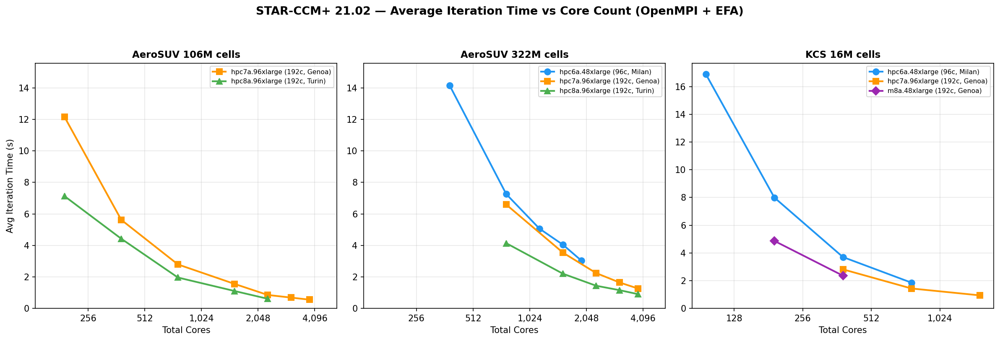

# STAR-CCM+

[Siemens Simcenter STAR-CCM+](https://plm.sw.siemens.com/en-US/simcenter/fluids-thermal-simulation/star-ccm/) is a multiphysics computational fluid dynamics (CFD) simulation software that enables engineers to model the complexity and explore the possibilities of products operating under real-world conditions. Recent software versions have included the capability to carry out Finite Element Analysis studies, and other physics phenomena that can be modelled in the software include battery and combustion modelling.

## Versions

There are 3 releases of STAR-CCM+ per year. There are two platform builds — x86 and Arm — each available for both Linux and Windows. There are also separate mixed precision and double (higher) precision builds available. Each of these have slightly different solve speeds and compute requirements with the double precision version (labelled -R8) having the higher requirements of the two. GPGPU compute capability is included within the x86 build (not a separate build). While submit scripts are mostly common across versions, there are nuances for x86, Arm and GPGPU usage to consider. The submit scripts in this repository are organised by version and architecture under `scripts/`.

The current release is 2606 (21.04.007). The 21.02 scripts run it with `-v 21.04.007`; the x86 scripts were checked on 2510 (20.06.010), 2602 (21.02.007) and 2606 (21.04.007). Its release notes announce two changes for 2610 that affect scripts: `-benchmark` will write JSON instead of XML files, and `-cpubind` will always need a value (for example `-cpubind bandwidth`).

## OS Compatibility

STAR-CCM+ works on many flavours of Linux, but by default is only supported on a small number of them. Recommended operating systems for running on AWS are Amazon Linux 2023, Ubuntu, or RHEL8+. Note that from STAR-CCM+ 2402 (19.02) onwards glibc >= 2.28 is required, so Amazon Linux 2 (glibc 2.26) runs 2310 (18.06) and earlier only. Amazon Linux 2 is end-of-life and should not be used.

| STAR-CCM+ Version | AL2023 | Ubuntu | RHEL8+ |
|-------------------|:-:|:-:|:-:|
| 18.06 (x86/GPU) | ✓ | 20.04+ | ✓ |
| 18.06 (Arm) | ✓ | 20.04+ | ✓ |
| 21.02 (all) | ✓ | 20.04+ | ✓ |
| 2606 (21.04, x86) | ✓ | 24.04 | 8.10, 9.6, 10 |

For 2606, Siemens certifies these Linux x86_64 platforms: Amazon Linux 2023, RHEL 8.10, 9.6 and 10, Rocky and Alma Linux 8.10, 9 and 10, SUSE Linux Enterprise Server 15.7 and 16, and Ubuntu 24.04 (Simcenter STAR-CCM+ 2606 Installation Guide).

## Installation

Since 2410 the Linux installer is a `.aol` executable inside the downloaded archive, and its options changed. To install 2606 on a non-GUI based cluster without prompts:

```
tar -xzf Simcenter_STAR-CCM+_2606-Linux-x64-mixed.tar.gz
./starccm+_21.04.007/STAR-CCM+2606_007_linux-x86_64-2.28_clang20.1.aol -i silent \
    -DPRODUCTEXCELLENCEPROGRAM=decline -DINSTALLDIR=/fsx/Siemens \
    -DINSTALL_LICENSING=false -DADDSYSTEMPATH=false -DINSTALL_DOC=false
```

This installs into `/fsx/Siemens/21.04.007/STAR-CCM+21.04.007`, the path the submit scripts build from `-v 21.04.007`, without the license server or documentation (the latter makes up a large chunk of the install size but may be useful; set `-DINSTALL_DOC=true` to keep it). `-i console` asks you to accept the license agreement and choose the location in the console, so it suits an interactive install only. `-DPRODUCTEXCELLENCEPROGRAM` takes `agree` or `decline`; `-DINSTALL_LICENSING` and `-DINSTALL_DOC` replace the older `-DINSTALLFLEX` and `-DNODOC`. `-DADDSYSTEMPATH=false` leaves users' shell profiles unchanged: the scripts call STAR-CCM+ by its full path, so several versions can sit side by side.

For 18.06 and earlier, which ship a `.sh` installer, the command is:

```
./STAR-CCM+_installer_.sh -i console -DPRODUCTEXCELLENCEPROGRAM=0 -DINSTALLDIR=/fsx/Siemens -DINSTALLFLEX=false -DADDSYSTEMPATH=true -DNODOC=false
```

Please read the STAR-CCM+ installation guide for more information on parameters that can be set at install time.

## Key Settings

### License

There are multiple ways to license STAR-CCM+. The two most common methods are

- host a vendor supplied license on a license server
- use Power on Demand (PoD) which checks out a license from a Siemens hosted license server

Each method has its advantages and disadvantages, however it's worth noting that Power on Demand licenses are significantly easier to use with AWS: as long as the instance can reach the Siemens license server (`flex.cd-adapco.com`, ports 1999 and 2099), the license gets checked out.

The 21.02 x86 submit scripts pass the PoD key to STAR-CCM+ in the `LM_PROJECT` environment variable, the variable STAR-CCM+'s launcher sets from `-podkey`, so the key is not on STAR-CCM+'s command line. That matters because STAR-CCM+ writes its command line into its log, and a `-benchmark` run also into its XML and HTML reports, so a key passed with `-podkey` ends up in those files. The scripts take the key from the `PODLIC` environment variable, from `-l`, or, when `PODLIC_SSM_PARAMETER` names an AWS Systems Manager Parameter Store parameter, from that parameter when the job starts. Reading it in the job keeps it out of files and job records:

```bash
# Once: store the key as a SecureString parameter; type the key at the silent prompt
read -rs PODKEY && printf %s "$PODKEY" | aws ssm put-parameter --name /starccm/pod-key --type SecureString --value file:///dev/stdin; unset PODKEY
# Each job: name the parameter; the job reads the key when it starts
PODLIC_SSM_PARAMETER=/starccm/pod-key sbatch submit_batch.sbatch -v 21.04.007 -s /fsx/simulations/model.sim
```

The nodes' instance role then needs `ssm:GetParameter` on that parameter (and `kms:Decrypt` for a customer-managed key). Avoid `-l <key>` on shared clusters, since Slurm keeps a job's arguments in its job record (`scontrol show job`), and avoid plaintext copies of the key such as `~/.bashrc`.

If running a license server on AWS, consider the following:

- Use a dedicated Elastic Network Interface (ENI) attached to the license server EC2 instance. This ensures the MAC address (which FlexLM ties the license to) persists even if the instance is terminated and replaced.
- For additional resilience, FlexLM supports a triad of license servers. This provides redundancy — if one server goes down, the remaining two can continue to serve licenses.
- Alternatively, a VPN connection can be used to reach a license server running outside of AWS.

### MPI

OpenMPI is the default and recommended MPI for Linux per the Siemens STAR-CCM+ installation guide; 2606 bundles Open MPI 5.0.9 and Intel MPI 2021.16.1. Use OpenMPI on AMD-based instances (e.g. hpc8a, hpc7a, hpc6a): all 21.02+ scripts in this repository use it.

Intel MPI remains viable on Intel instances (hpc6id, c7i, c8i) and is retained in the 18.06 scripts where the version bundled with STAR-CCM+ works reliably across all tested platforms.

| Version | x86 | GPU | Arm |
|---------|-----|-----|-----|
| 18.06 | Intel MPI | Intel MPI | OpenMPI |
| 21.02+ | **OpenMPI** | **OpenMPI** | OpenMPI |

For OpenMPI, the key STAR-CCM+ flags are:

```
-mpi openmpi -xsystemlibfabric -ldlibpath /opt/amazon/efa/lib64 -fabric OFI
```

For Intel MPI (18.06 only), the environment variables required are:

```bash
export I_MPI_OFI_LIBRARY_INTERNAL=0
export I_MPI_FABRICS=shm:ofi
export I_MPI_OFI_PROVIDER=efa
export I_MPI_MULTIRAIL=1
```

### CPU Binding

No `-cpubind` flag is needed in the submit scripts. STAR-CCM+ defaults to `-cpubind bandwidth`, which maximises memory bandwidth across NUMA nodes; keep that default on AMD multi-CCD architectures (hpc8a, hpc7a).

To run fewer ranks per node than the node has cores, use 24, 48, 72, 96, 120, 144, 168 or 192 ranks per node on hpc7a.96xlarge and hpc8a.96xlarge: these counts give every CCD the same number of cores, as described in [Utils/flexible-cores](https://github.com/aws-samples/hpc-applications/tree/main/Utils/flexible-cores). STAR-CCM+'s default binding then spreads the ranks evenly over the 24 CCDs: on hpc8a.96xlarge with 2606, `-cpubind bandwidth,v` (the `v` prints each rank's core) showed the same number of ranks on every CCD, 6 at 144 ranks per node (exactly the cores of the flexible-cores list) and 4 at 96 (each CCD's first four cores, where the list takes every other core).

### Node preparation

Before the solve the submit scripts drop the page cache and set transparent huge pages (THP) to `always` on every node — the same two lines the other apps' scripts use. On one small model (reactor, 192 ranks on hpc8a.96xlarge) THP `always` ran about 2% faster than the `madvise` default (relative to that model at `madvise` = 1.00); the effect may be larger on bigger, more memory-bound models.

## Submit Scripts

Submit scripts are provided under `scripts/` organised by STAR-CCM+ version and architecture. Each directory contains a `submit_batch.sbatch` for headless batch runs and a `submit_server.sbatch` for interactive server mode (connect via the STAR-CCM+ GUI).

See [`scripts/README.md`](scripts/README.md) for full usage documentation, flag reference, and customisation options. Not setting `-m` options will cause the simulation to start running/solving.

```
scripts/
├── 18.06/                    # STAR-CCM+ 18.06 (works on AL2, AL2023, RHEL8, Ubuntu)
│   ├── x86/                  # Intel MPI
│   ├── gpu/                  # Intel MPI + GPU offload
│   └── arm/                  # OpenMPI (Intel MPI is x86-only)
└── 21.02/                    # STAR-CCM+ 21.02+ (requires glibc >= 2.28)
    ├── x86/                  # OpenMPI (recommended for all platforms)
    ├── gpu/                  # OpenMPI + GPU offload
    └── arm/                  # OpenMPI
```

Quick start:

```bash
# x86 batch run (default version is 21.02.007)
sbatch scripts/21.02/x86/submit_batch.sbatch -s /fsx/simulations/model.sim

# Specify a version explicitly
sbatch scripts/21.02/x86/submit_batch.sbatch -v 21.02.007 -s /fsx/simulations/model.sim

# Run with a Java macro
sbatch scripts/21.02/x86/submit_batch.sbatch -s /fsx/simulations/model.sim -m RunAndTimeSimulation.java

# Chain multiple batch commands (macro, then mesh, then solve)
sbatch scripts/21.02/x86/submit_batch.sbatch -s model.sim -m "macro.java,mesh,run"

# GPU batch run
sbatch scripts/21.02/gpu/submit_batch.sbatch -v 21.02.007 -s /fsx/simulations/model.sim

# Server mode (connect via STAR-CCM+ GUI)
sbatch scripts/21.02/x86/submit_server.sbatch -v 21.02.007 -s /fsx/simulations/model.sim
```

## Macros

### RunAndTimeSimulation.java

A benchmarking macro that runs configurable warmup + timed iterations, measures solve time and memory, exports all simulation reports, and writes results to CSV and JSON. See [`macros/RunAndTimeSimulation.java`](macros/RunAndTimeSimulation.java) for full documentation.

This macro has been used internally at AWS for STAR-CCM+ benchmarking in place of the default `starccm+ -benchmark` flag. It provides more control over the benchmarking process — configurable warmup iterations, per-step timing, memory measurement, and report export — and works with both steady and unsteady simulations. For the models of Siemens's own benchmark suite, use `-benchmark` with Siemens's protocol instead (see [Timing Siemens's benchmark models](#timing-siemenss-benchmark-models)). The macro clears the solution before it runs (`clearSolution = true`), unlike Siemens's protocol for the AeroSUV, vtmBenchmark and HlMach10Sou models; set `clearSolution=false` in a `benchmark_config.properties` file in the job directory to continue from the model's solution. It also appends every run's timings to `/fsx/benchmarks/MasterBenchmarkReport.csv` (`masterFileLoc`).

**Use at your own risk.** This is not officially supported by Siemens. It is written in a readable form so is easy to audit.

Usage:

```bash
sbatch scripts/21.02/x86/submit_batch.sbatch -s /fsx/simulations/model.sim -m RunAndTimeSimulation.java
```


## Timing Siemens's benchmark models

For the models of Siemens's STAR-CCM+ benchmark suite (AeroSUV, LeMans 100M, civil, reactor, TurboCharger7M, vtmBenchmark, ...), Siemens asks for STAR-CCM+'s own `-benchmark` mode with the protocol it gives for each model, performance reported as the `AverageElapsedTime` of the XML file `-benchmark` writes, and 3 or more runs per test point:

| Model | `-benchmark` options |
|---|---|
| AeroSUV, steady (coupled and segregated) | `-preits 5 -nits 20` |
| LeMans 100M (coupled and segregated), civil, reactor, TurboCharger7M, lemans_poly_17m | `-preits 40 -nits 20 -preclear` |
| vtmBenchmark, HlMach10Sou | `-preits 40 -nits 20` |
| DrivAer WMLES 128M | `-preits 10 -nits 20` |

For example, on two nodes with the 21.02 x86 script's settings:

```bash
starccm+ -pio -bs slurm -power -licpath 1999@flex.cd-adapco.com \
    -mpi openmpi -xsystemlibfabric -ldlibpath /opt/amazon/efa/lib64 -fabric OFI \
    -benchmark "-preits 5 -nits 20 -nps 384" AeroSUV_Steady_Coupled_106M_V17_04_005.sim
```

`-benchmark` ignores the model's own stopping criteria, records the time of every timed iteration as well as the first iteration and the pre-iterations, and starts the server twice (once to collect system information), so its log shows two license checkouts and two loads of the model. The pre-iterations matter after `-preclear`: on LeMans 100M segregated (one hpc8a.96xlarge, 2606), iterations 3 to 22 after `-preclear` took 9.3% longer on average than iterations 43 to 102, and iterations 23 to 42 1.4% longer, so Siemens's 40 pre-iterations put the timed iterations on the plateau. Continuing AeroSUV 106M coupled from the solution it ships with, only the first iteration stands apart; after it, the coupled solver's time per iteration follows its AMG cycles per iteration (4 to 9 in these runs) rather than a trend. The number of pre-iterations that settles a model depends on the model, so check that the per-iteration time has flattened before the timed window rather than assuming a fixed count: civil (segregated, external aerodynamics) needed more than Siemens's 40 — with 40 pre-iterations its first 20 timed iterations still ran about 5% slower than the settled iteration time, so time it with about 120 pre-iterations instead, while reactor, vtmBenchmark and AeroSUV 322M were already settled at their protocols.

## Benchmarking Summary

AWS has benchmarked STAR-CCM+ 21.02 across a range of x86, Arm, and GPU instance types using OpenMPI with EFA. All CPU benchmarks below used full-node core counts (96 cores/node for hpc6a, 192 cores/node for hpc7a and hpc8a), 100 warmup iterations discarded, and 500 timed iterations.

### Scaling Comparison — hpc6a vs hpc7a vs hpc8a



The chart above compares average iteration time (lower is better) across three simulation cases:

- **AeroSUV 106M** — External aerodynamics, steady coupled solver, 106 million cells. Good scaling across all three instance families out to 20 nodes. hpc8a is consistently ~35–40% faster than hpc7a at the same core count.
- **AeroSUV 322M** — Same geometry at 322 million cells. Only hpc7a and hpc8a have sufficient memory per node to run this case efficiently - hpc6a benefits from 50% under-subscription. hpc8a maintains its advantage, reaching sub-1s/iter at 20 nodes (3,840 cores).
- **KCS 16M** — Ship hull hydrodynamics (unsteady, Segregated solver), 16 million cells. A smaller case that saturates earlier — scaling tails off beyond ~768 cores as communication overhead dominates.


### Key Takeaways

- **OpenMPI is now the default.** Use it on AMD instances (hpc6a, hpc7a, hpc8a); the 21.02+ scripts do.
- **Keep the default CPU binding.** STAR-CCM+'s default, `-cpubind bandwidth`, maximises memory bandwidth across NUMA nodes; the submit scripts leave it as is.
- **Discard the warm-up iterations when benchmarking, and check the per-iteration time has flattened before the timed window** rather than assuming a fixed count. Siemens's protocols use 40 pre-iterations after `-preclear`, and 5 when a model continues from the solution it ships with (see [Timing Siemens's benchmark models](#timing-siemenss-benchmark-models)), but the count that settles a model varies with the model — some need more (civil needed about 120, not 40).
- **AL2023 is the recommended OS** for x86 and GPU instances (glibc 2.34). Amazon Linux 2 is no longer compatible with STAR-CCM+ 2402 and later.

## Contribute your results

The benchmark scripts in this folder call [`dynamodb/record-benchmark.sh`](dynamodb/record-benchmark.sh) after every successful run. The recorder saves the run as a small JSON record (`<record_id>.json`) and adds it to the shared AI-Powered HPC benchmark dataset when you have write access to it. That dataset trains a model that predicts HPC performance on AWS, so every result you share helps. Set `SOURCE=<YourOrg>` to tag your runs, and see [BENCHMARK-RECORDERS.md](../BENCHMARK-RECORDERS.md) for the options and how to send the record in.
